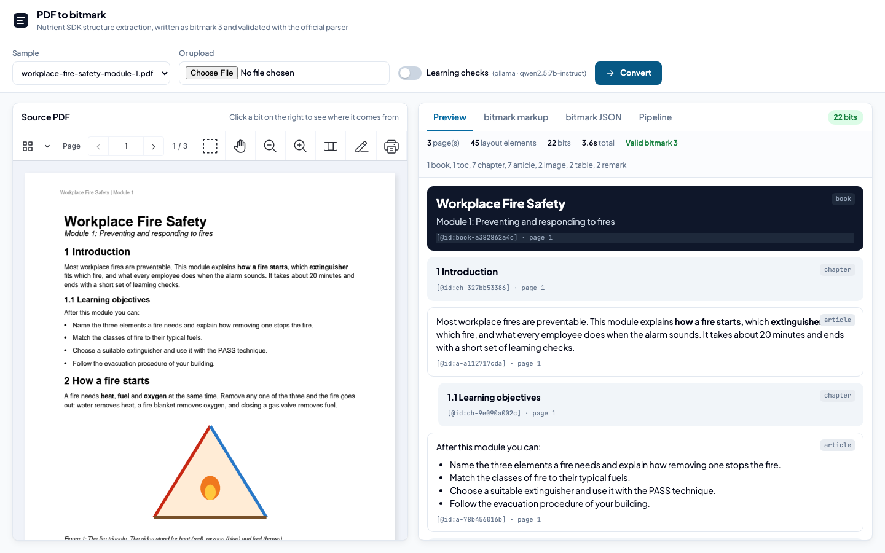
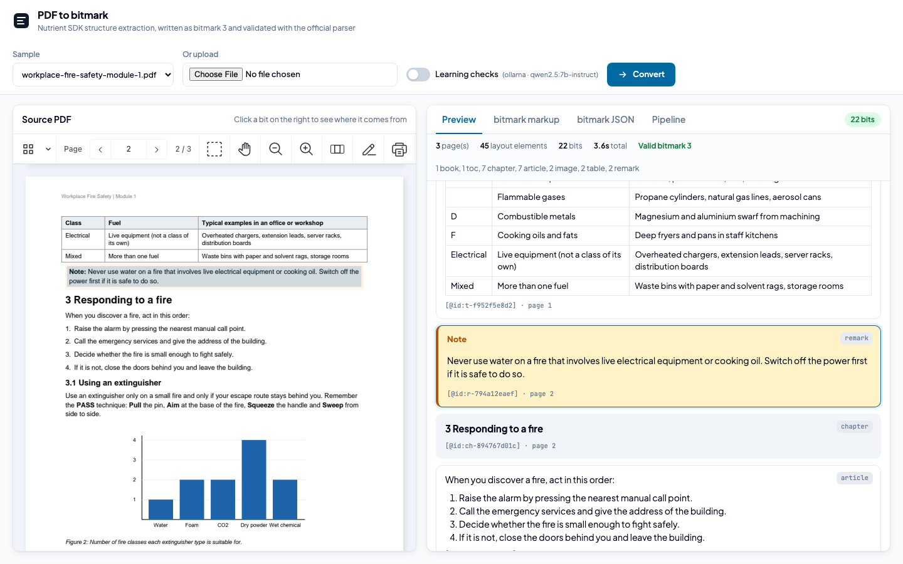
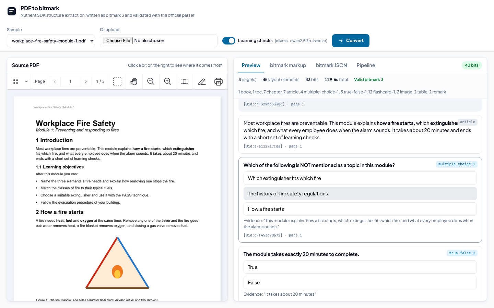

# Nutrient PDF to bitmark

A Nutrient.io demo that converts a PDF (course material, a textbook chapter, a standard) into a bitmark book, the open content standard of the bitmark Association, and shows where each bit comes from in the source PDF.



1. **Layout.** The Nutrient Python SDK `Vision.extract_content()` returns the layout elements in reading order: section headings with their level, paragraphs, list items, tables with cells and pictures, each with a bounding box at 200 dpi. The SDK also renders one PNG per page.
2. **bitmark.** `bitmark_writer.py` maps the elements to bitmark 3 with fixed rules:
   - headings become chapters, with the level taken from the numbering depth;
   - runs of paragraphs and list items become articles, with bold runs, bullet lists and numbered lists;
   - tables become `[.table]` bits with a header row; a table split across pages is merged;
   - pictures become `[.image]` bits cropped from the page render, with their caption;
   - paragraphs that start with "Note:", "Remember:", "Tip:" or "Warning:" become `[.remark]` bits.
3. **Learning checks (optional).** One LLM call per chapter, with the chapter text only and a JSON schema, returns multiple-choice, true/false and flashcard bits. Each question quotes one sentence of the chapter as evidence. The sentence is located in the layout, so a question links back to its source like any other bit. Questions whose evidence is not found are dropped.
4. **Validation.** The official bitmark parser (`@gmb/bitmark-parser-generator`) checks the markup and writes the bitmark JSON.
5. **Review.** The web UI shows the PDF in the Nutrient Web SDK next to the bits. Clicking a bit highlights its source region in the PDF.

Every bit gets an `[@id:...]` made from a hash of its normalized content. A bit whose text does not change keeps its id when the PDF is converted again, so comments attached to a bit survive a content update.

Each conversion writes these files to `outputs/<hash>/`:

| File | Content |
|---|---|
| `book.bitmark` | bitmark markup |
| `book.json` | The same content as bitmark JSON, from the official parser |
| `images/` | Figures cropped from the page renders |
| `provenance.json` | Bit id to page and bounding box in the source PDF |
| `validation.json` | Parser report: bit counts and problems |

## Prerequisites

- Python 3.12 or later
- Node.js 20 or later and npm
- macOS on Apple Silicon or Linux x86_64 (the Nutrient Python SDK native runtimes)
- About 1 GB of disk space for the Nutrient vision models, downloaded on the first run
- Optional, for the learning checks: an OpenAI or Anthropic API key, or Ollama with a local model such as `qwen2.5:7b-instruct`

## Environment variables

Copy `.env.example` to `.env`. `run.sh` loads it. Keys are only read from environment variables, never from code.

| Variable | Purpose | Default |
|---|---|---|
| `NUTRIENT_LICENSE_KEY` | Nutrient Python SDK license key | empty = evaluation mode |
| `NUTRIENT_WEB_LICENSE_KEY` | Nutrient Web SDK license key, served to the browser by `GET /api/config` | empty = evaluation mode |
| `AI_PROVIDER` | `openai`, `anthropic` or `ollama` for the learning checks | detected from the keys present, else `ollama` |
| `AI_MODEL` | Model for the learning checks | `gpt-4o-mini`, `claude-sonnet-5` or `qwen2.5:7b-instruct` |
| `AI_ENDPOINT` | OpenAI-compatible base URL, or the Ollama URL | `https://api.openai.com/v1` or `http://localhost:11434` |
| `OPENAI_API_KEY` | OpenAI key | empty |
| `ANTHROPIC_API_KEY` | Anthropic key | empty |
| `BOOK_LANGUAGE` | Value of `[@language:...]` on the book bit | `en` |
| `LAYOUT_CONFIDENCE` | Layout model threshold. The SDK default of 0.5 drops regions on form-like pages | `0.2` |
| `OUTPUT_DIR` | Folder for the conversions, also used as a cache by content hash | `outputs` |
| `PORT` | Server port | `8082` |

In evaluation mode the Python SDK replaces part of the extracted text with a notice, so some bits show that notice instead of the document text. Set `NUTRIENT_LICENSE_KEY` for complete output.

## Build and run

```bash
cp .env.example .env
```

```bash
pip install -r backend/requirements.txt
```

```bash
cd backend && npm install && cd ..
```

```bash
./run.sh
```

Open <http://localhost:8082>.

The viewer loads the Nutrient Web SDK 1.6.0 from `https://cdn.cloud.pspdfkit.com/pspdfkit-web@1.6.0/`. To change the version, update the script tag in `frontend/index.html` and `SDK_BASE_URL` in `frontend/app.js`.

With Ollama, the learning checks work offline but take 1 to 2 minutes per chapter on a laptop.

### Command line

```bash
cd backend && python3 convert.py ../samples/workplace-fire-safety-module-1.pdf ../outputs/cli --quiz
```

`--quiz` is optional and adds the learning checks.

## Using the app

1. Pick the sample or upload a PDF.
2. Turn on **Learning checks** to add generated questions. The label shows the provider and model in use.
3. Click **Convert**. The status pill and the **Pipeline** tab show each step with its time.
4. The **Preview** tab shows the bits. Click a bit to highlight its source in the PDF. Quiz bits are interactive: click an answer, or click a flashcard to flip it.

   

   

5. The **bitmark markup** and **bitmark JSON** tabs show the result, with **Copy** and **Download**.

A PDF that was already converted is loaded from `outputs/` without running the pipeline again.

## API

| Method and path | Description |
|---|---|
| `GET /api/samples` | `[{ name, size }]` for the PDFs in `samples/` |
| `GET /api/config` | `{ quizProvider, quizModel, licensed, webLicenseKey }` |
| `POST /api/convert` | Multipart `file`, or `sample` with a sample name, plus `quiz_on` (`1` or `0`). Returns `{ id }` |
| `GET /api/job/{id}` | `{ id, status, log, result, error }`. `status` is `running`, `done` or `error` |
| `GET /api/pdf/{id}` | The source PDF of a job |
| `GET /jobs/{id}/...` | Job files: `book.bitmark`, `book.json`, `images/`, `pages/` |

## Sample

`samples/workplace-fire-safety-module-1.pdf` is a fictitious three-page training module with numbered headings on two levels, bold runs, bullet and numbered lists, two tables (one continues on the next page), two figures with captions and a "Note" and a "Remember" box. To regenerate it:

```bash
pip install -r samples/requirements.txt
```

```bash
python samples/generate_sample.py
```

## Layout

| Path | Role |
|---|---|
| `backend/structure.py` | Nutrient Python SDK calls: layout JSON, page renders, figure crops |
| `backend/bitmark_writer.py` | Layout elements to bitmark markup and provenance |
| `backend/quiz.py` | Learning checks (optional LLM step) |
| `backend/validate.js` | Official bitmark parser: markup to JSON and report |
| `backend/app.py` | FastAPI server |
| `backend/convert.py` | Command line entry point |
| `frontend/` | UI in plain JavaScript, no build step |
| `samples/` | Sample course module and its generator |

The remark and caption rules also recognize the German and French labels (for example "Merke:", "Hinweis:", "Abbildung"), so course material in those languages converts the same way.
